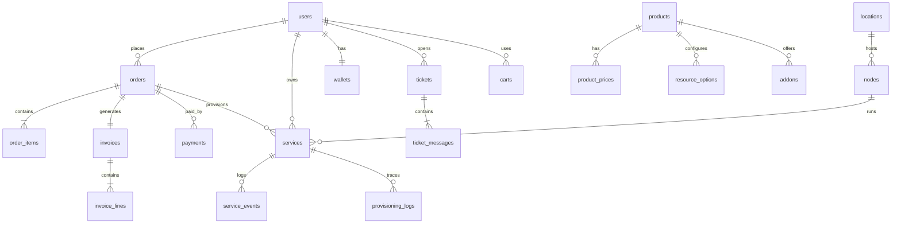

# Database

Fonte unica dello schema: `src/Core/Schema.php`. Da lì vengono generati sia il
DDL MariaDB sia le tabelle SQLite usate da demo e test. Il DDL MariaDB è anche
committato in `database/schema.mariadb.sql` (`php bin/console schema:dump`).

- Produzione: MariaDB 11.8, `utf8mb4_unicode_ci`, InnoDB.
- Sviluppo/test: SQLite (WAL, foreign keys attive).
- Migrazioni: `database/migrations/*.php`, registrate in `migrations` con batch.
  `Schema::install()` è idempotente, quindi la migrazione iniziale può essere
  rieseguita su un database esistente.

## Convenzioni

| Tipo | Regola |
|---|---|
| Chiavi | `id` intero autoincrementale |
| Denaro | `*_cents` INTEGER, mai decimali |
| Date | `*_at` TEXT/`DATETIME` in UTC (`Database::now()`) |
| JSON | `*_json` TEXT, sempre con `Json::encode/decode` |
| Stati | stringhe corte, validate dalle state machine |
| Soft delete | `deleted_at` su utenti; fatture mai cancellate |
| Indici | su email blind index, stato, date di scadenza, chiavi esterne |

## Mappa delle tabelle

### Identità e accesso

| Tabella | Ruolo |
|---|---|
| `users` | account, ruolo, stato, 2FA, profilo fatturazione |
| `user_sessions` | sessioni server-side (revoca, IP, user agent) |
| `password_resets` | token di reset (hash, scadenza, usato) |
| `email_verifications` | verifica email non bloccante (token hash) |
| `legal_acceptances` | prova dell'accettazione di termini/privacy per utente |

Email e dati fiscali sensibili sono cifrati (AES-256-GCM) e ricercabili tramite
`email_index` (HMAC-SHA256 con `BLIND_INDEX_KEY`).

### Catalogo

| Tabella | Ruolo |
|---|---|
| `categories` | raggruppamento del catalogo |
| `products` | piano base, software, egg/nest Pterodactyl, visibilità |
| `product_prices` | prezzo per ciclo e valuta (centesimi) |
| `resource_options` | min/max/step/incluso/prezzo unitario per RAM, CPU, disco |
| `addons` | extra (backup, slot, plugin) |
| `product_addons` | associazione add-on ↔ prodotto |
| `locations` | sede, note DDoS, ordinamento |

### Carrello e ordini

| Tabella | Ruolo |
|---|---|
| `carts` | carrello per token di sessione, utente, stato |
| `cart_items` | prodotto, ciclo, configurazione JSON, prezzo |
| `orders` | numero `ORD-YYYY-NNNNN`, stato, totali, rischio, note |
| `order_items` | righe d'ordine con prezzo congelato |
| `coupons` | percentuale/fisso, scadenza, limiti d'uso |
| `coupon_redemptions` | uso per utente/ordine (anti-abuso) |

### Fatturazione

| Tabella | Ruolo |
|---|---|
| `invoices` | numero `A-YYYY-NNNN`, stato, imponibile/IVA/totale |
| `invoice_lines` | righe con aliquota, quantità, prezzo unitario |
| `credit_notes` | note di credito per storni |
| `sequences` | contatori annuali transazionali per ordini/fatture/ticket |

Un ordine e la sua fattura nascono nella stessa transazione; la numerazione non
può avere buchi o duplicati perché `Sequences::next()` blocca la riga.

### Pagamenti e wallet

| Tabella | Ruolo |
|---|---|
| `payments` | tentativo/incasso per gateway, importo, external id |
| `payment_methods` | metodi salvati per il rinnovo automatico (token) |
| `webhook_events` | eventi ricevuti, univoci per gateway+external id |
| `wallets` | saldo in centesimi per utente |
| `wallet_transactions` | ledger append-only (acquisto, rinnovo, rimborso, credito) |
| `wallet_topups` | richieste di ricarica con bonifico e conferma admin |

Il saldo è sempre calcolato dal ledger; `wallets.balance_cents` è una cache
aggiornata nella stessa transazione.

### Servizi e provisioning

| Tabella | Ruolo |
|---|---|
| `services` | servizio attivo, ciclo, scadenza, stato, config, dati Pterodactyl |
| `service_events` | storico transizioni e comandi (power, sospensione, ecc.) |
| `provisioning_logs` | passi del provisioning, richieste/risposte, errori |
| `nodes` | nodi Pterodactyl mappati, capacità, manutenzione |
| `announcements` | comunicazioni e incidenti mostrati in status page |

`services.provision_key` è la chiave di idempotenza: un retry non crea un secondo
server. `pterodactyl_server_id` è univoco quando presente.

### Supporto e contenuti

| Tabella | Ruolo |
|---|---|
| `tickets` | numero `T-YYYY-NNNNN`, reparto, priorità, stato |
| `ticket_messages` | messaggi cliente/staff |
| `ticket_attachments` | metadati allegati (file fuori dalla document root) |
| `kb_articles` | knowledge base pubblica |
| `legal_documents` | termini, privacy, AUP, rimborsi, SLA, cookie |

### Sistema

| Tabella | Ruolo |
|---|---|
| `settings` | impostazioni tipizzate in JSON (brand, tasse, automazioni) |
| `feature_flags` | attivazione funzionalità per installazione |
| `audit_logs` | chi ha fatto cosa, prima/dopo, IP, user agent |
| `mail_log` | email inviate (destinatario, oggetto, stato) |
| `jobs` | coda (default/provisioning) con retry e backoff |
| `license_state` | licenza verificata, piano, scadenza, ultima verifica |
| `migrations` | migrazioni applicate e batch |

## Diagramma semplificato

## Query e prestazioni

- Solo prepared statement; nessuna interpolazione di valori.
- Indici principali: `users.email_index`, `services.status`, `services.next_due_at`,
  `invoices.status`, `orders.status`, `jobs(queue, available_at)`.
- Dashboard admin: aggregati su `orders.paid_at` e `services.status`; su volumi
  grandi conviene una vista materializzata notturna.
- Prune: `bin/console prune` elimina log e job oltre la retention configurata.

## Backup

Vedere [08-backup-dr.md](08-backup-dr.md). In sintesi: `mysqldump
--single-transaction` ogni notte + binlog se si vuole point-in-time recovery;
il file SQLite è solo per demo, non per produzione.
